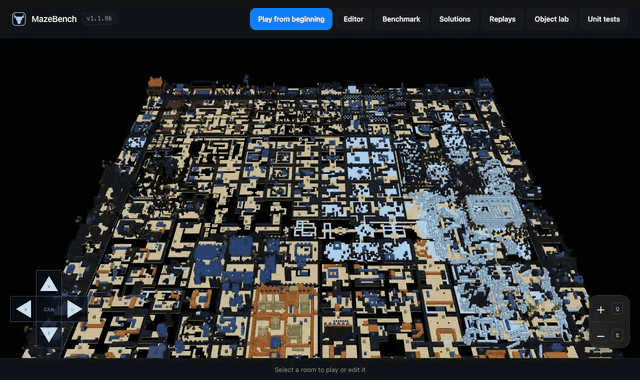
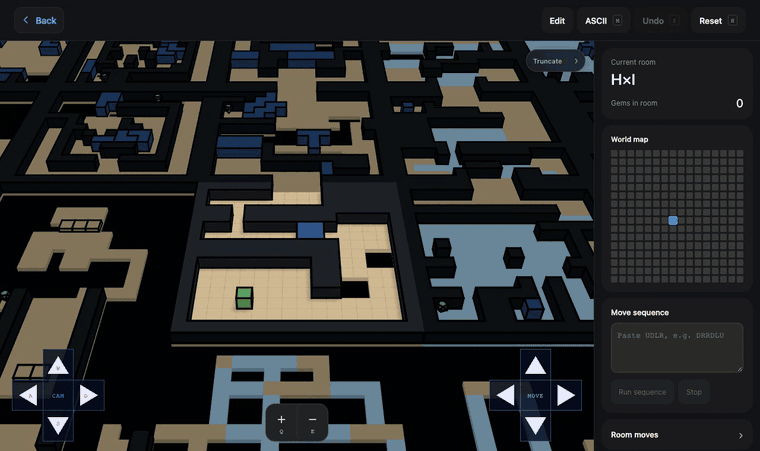
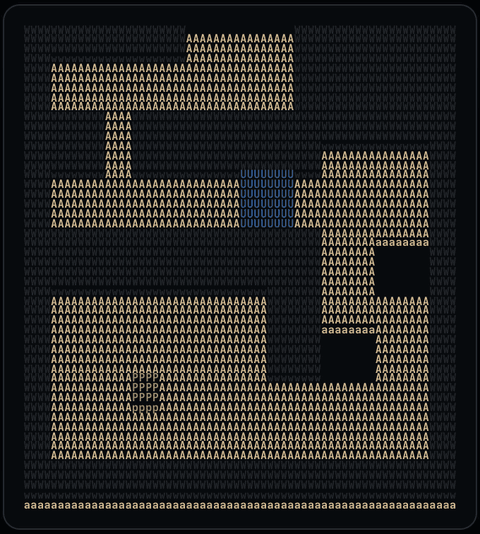
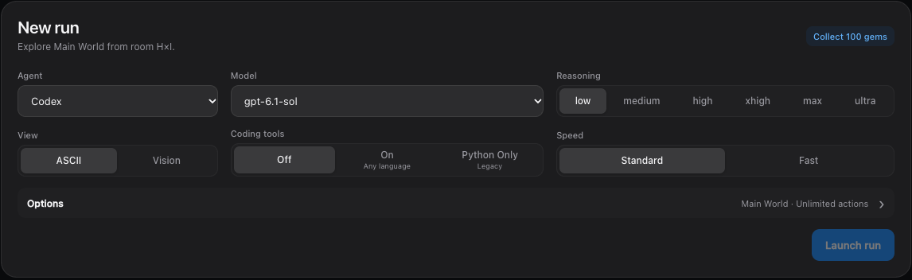
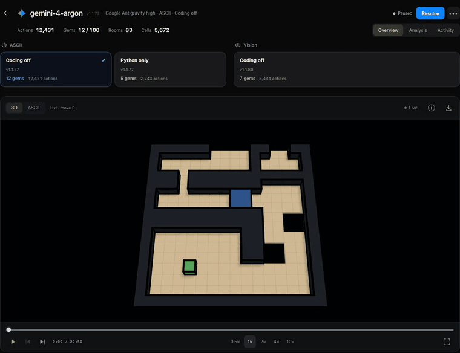

<div align="center">


# MazeBench

**An open-world puzzle benchmark for AI agents.**<br>
256 connected rooms · 100 gems · one long episode, played only through game tools.



[Quick start](#quick-start) ·
[Play](#play-it-yourself) ·
[What agents see](#what-agents-see) ·
[Run a benchmark](#run-a-benchmark) ·
[Watch runs](#watch-and-compare-runs) ·
[Versions](#versions-and-integrity) ·
[Develop](#develop-the-engine)

</div>

---

## What is MazeBench?

MazeBench drops an agent into one connected world: a 16 × 16 grid of rooms, each
16 × 16 tiles, holding 100 gems. The agent sees only the room it is standing in.
Walking off an edge enters the neighbouring room, and every room is a small physics
puzzle: ice that keeps you sliding, slopes, crates, buttons that lower orange walls,
lifts, punchers, clones and pits.

Agents are told the controls and little else. They must learn the mechanics by
playing, remember what they found across hundreds of rooms, and keep a plan going
for tens of thousands of moves. A verified 100-gem route takes about 40,500 commands.

|                  |                                                                                         |
| ---------------- | --------------------------------------------------------------------------------------- |
| **Goal**         | Collect all 100 gems. Gems are tracked by identity and never respawn.                   |
| **Start**        | Room H×I                                                                                |
| **Actions**      | `up` `down` `left` `right`, UDLR sequences, `undo`, `reset`, `camera …`, `room X×Y`     |
| **Observations** | The current room as ASCII text, or as a rendered PNG in Vision mode                     |
| **Conditions**   | Coding off, Python only, or Any language (sandboxed)                                    |
| **Telemetry**    | Gems, rooms visited, distinct cells, novelty, tokens and API-equivalent cost            |

## Quick start

You need [Node.js](https://nodejs.org) 22.13 or newer.

```bash
node server.mjs
```

Open **http://localhost:8080**. The site itself needs no install or build step. Keep
the terminal open, and press <kbd>Ctrl</kbd>+<kbd>C</kbd> to stop.

`npm start` does the same and also builds the Unit tests page. Run `npm ci` once
before using Vision runs, the Any-language sandbox, or the development tools.

Every tool is one click from the world map:

| Page           | Path                   | What it's for                                         |
| -------------- | ---------------------- | ----------------------------------------------------- |
| **World map**  | `/`                    | Fly over all 256 rooms and pick one to play or edit   |
| **Play**       | `/play/v1/?room=HxI`   | Play the world yourself, in 3D or ASCII               |
| **Benchmark**  | `/benchmarking/v1/`    | Launch agent runs and follow them live                |
| **Replays**    | `/replays/v1/`         | Turn UDLR move lists into smooth replay movies        |
| **Solutions**  | `/solutions/v1/`       | Search for and store routes through the world         |
| **Editor**     | `/editor/v1/?room=HxI` | Build and adjust rooms                                |
| **Object lab** | `/object-lab/`         | Preview individual blocks and objects in 3D           |
| **Unit tests** | `/unit-tests/`         | Step through the physics test suite                   |

## Play it yourself



Start at **Play from beginning**. Arrow keys move relative to the camera, so "up"
always means away from you.

| Action                  | Keyboard                       | Controller          |
| ----------------------- | ------------------------------ | ------------------- |
| Move                    | <kbd>←</kbd> <kbd>↑</kbd> <kbd>→</kbd> <kbd>↓</kbd> | Left stick or D-pad |
| Rotate / tilt camera    | <kbd>A</kbd> <kbd>D</kbd> / <kbd>W</kbd> <kbd>S</kbd> | Right stick         |
| Zoom                    | <kbd>Q</kbd> / <kbd>E</kbd>    | ZL / ZR             |
| Switch 3D ↔ ASCII       | <kbd>M</kbd>                   |                     |
| Undo                    | <kbd>Z</kbd>                   | Any right face button |
| Reset the room          | <kbd>R</kbd>                   |                     |

A few rules worth knowing:

- **Edges are doors.** Walk off a room's edge to enter its neighbour. Rooms you leave
  are restored when you come back.
- **Death is undoable.** Falling into a pit or getting crushed can always be undone.
- **Reset** restores the room as it was when you entered it.
- **Sequences.** Paste a UDLR string such as `RRUULD` into *Move sequence* to play it
  back. The *Room moves* panel records your moves in the same format.
- **Tweens** (smooth motion) can be switched off under *Playback settings*.

## What agents see



In ASCII mode, each tile is a 4 × 4 block of characters, so a room is at most
64 × 64 characters. Upper-case letters are top faces. Lower-case letters are the
sides you see when the camera is tilted.

Agents are told only that `P` is the player and `G` is a gem. Everything else must
be worked out by playing. For humans, here is the key to the common glyphs:

| Glyph | Meaning      | Glyph | Meaning          |
| :---: | ------------ | :---: | ---------------- |
| `P`   | Player       | `B`   | Crate            |
| `G`   | Gem          | `U`   | Weightless box   |
| `A`   | Floor        | `O`   | Orange wall      |
| `W`   | Wall         | `8`   | Orange button    |
| `I`   | Ice          | blank | Drop / pit       |

<br clear="right">

Agents act through a small MCP tool set:

| Tool            | What it does                                                                 |
| --------------- | ---------------------------------------------------------------------------- |
| `maze_observe`  | Returns the board and game state, or reads an earlier move's frames. Free.   |
| `maze_action`   | Applies one action, including `undo`, `reset`, `camera …` and `room X×Y`.    |
| `maze_sequence` | Applies a UDLR string or an explicit list. Each step counts as one action.   |
| `python_exec`   | *Python only:* runs code in an isolated, network-free workspace.             |
| `code_exec`     | *Any language:* runs code in a Docker sandbox.                               |

Every action records its full animation. Agents can read those frames at no cost,
which matters when one press sends the player sliding across a room of ice.

In **Vision** mode the board is a PNG of the 3D render instead, with no ASCII, object
list or coordinates. See [the vision setup](benchmarking/vision/README.md).

The exact prompts live in [`benchmarking/v1/EVAL-PROMPT.md`](benchmarking/v1/EVAL-PROMPT.md)
and [`benchmarking/vision/EVAL-PROMPT.md`](benchmarking/vision/EVAL-PROMPT.md).

## Run a benchmark



1. Install and sign in to the agent CLI you want to evaluate (see the table below).
2. Open **Benchmark** and choose the agent, model, reasoning effort, view (ASCII or
   Vision), coding tools and speed.
3. Under **Options**, pick the world (Main World, Ice Maze or Slotski) and an action
   limit. The default is unlimited.
4. Press **Launch run**. A live card appears; open it to watch.

| Agent              | Runs models through                    | Setup                                                    |
| ------------------ | -------------------------------------- | -------------------------------------------------------- |
| **Codex**          | OpenAI Codex CLI                       | Signed-in `codex`. A Fast speed tier is optional.        |
| **Claude Code**    | Anthropic Claude Code                  | `claude auth login`                                      |
| **Grok Build**     | xAI Grok Build                         | grok.com sign-in                                         |
| **Antigravity**    | Google Antigravity (Gemini)            | [Antigravity notes](benchmarking/antigravity/README.md)  |
| **Meta Muse Code** | Muse Code                              | [Muse notes](benchmarking/muse/README.md)                |
| **Kimi Code**      | Kimi Code                              | `npm run setup:kimi` · [Kimi notes](benchmarking/kimi/README.md) |
| **Prime Agent**    | Prime Intellect inference (open models) | [Prime notes](benchmarking/prime/README.md)             |

**Coding tools.** *Any language* needs Docker. Build its pinned toolchain once with
`npm run setup:code-sandbox`. *Python only* is the older, restricted Python condition.

**Isolation.** Every harness is locked down to the MazeBench tools. Shell, file access,
web, plugins, memory, personal settings and sub-agents are switched off, and any other
tool call invalidates the run. The prompt, model, effort, CLI binary hash and every
runtime file are pinned in a signed manifest that is re-verified throughout the run.
The full threat model is in [`benchmarking/v1/SECURITY.md`](benchmarking/v1/SECURITY.md).

<details>
<summary><b>Background services and ports</b></summary>

<br>

Most of these start with the site. Use the script to add one to a site that is
already running, without interrupting active runs.

| Port | Service                                          | Script                           |
| ---- | ------------------------------------------------ | -------------------------------- |
| 8080 | Main site and benchmark owner                    | `node server.mjs`                |
| 8082 | Vision runner (Codex, Claude Code)               | `npm run start:vision`           |
| 8083 | Capability service (Any language, newer modes)   | `npm run start:capabilities`     |
| 8084 | Model catalogs                                   | `npm run start:catalogs`         |
| 8085 | Read-only playback and reports                   | `npm run start:playback`         |
| 8086 | Vision runner (Gemini, Grok, Kimi, Muse)         | `npm run start:vision-providers` |
| 8087 | Recovery companion                               | `npm run start:recovery`         |
| 8090 | Versioned runtime releases (new Main World runs) | `npm run start:releases`         |
| 3001 | Physics test lab (optional)                      | `npm run dev:lab`                |

Vision launches need the vision runner and fail if it is offline; they never fall
back to ASCII. Image rendering uses Playwright with your local Chrome. Do not stop the
capability service while it owns an active Any-language run.

</details>

<details>
<summary><b>Automatic recovery</b></summary>

<br>

Some provider failures are retried without touching game state. Every attempt is
audited, retries are capped, and **Pause** or **Stop** always cancels a pending retry.

- **Codex:** transient 429/5xx failures resume the same conversation after
  15 s, 30 s, 1 min, 2 min, then 5 min. Vision runs also recover from unfinished
  `list_mcp_resources` calls.
- **Gemini vision:** "blocked by Gemini's filters" responses resume after 15 s,
  1 min, then 3 min. Retries stop after three attempts without new moves, or eight in
  an hour. Attempts are logged to `~/.mazebench/gemini-vision-recovery/retry-audit.jsonl`.
- **Grok vision:** matching-session HTTP errors resume with the same limits. Attempts
  are logged to `~/.mazebench/grok-vision-recovery/retry-audit.jsonl`.

The dashboard shows **Auto-resuming** while a retry is waiting and **Needs attention**
once retries are exhausted. Integrity violations always need a human review.

</details>

## Watch and compare runs



Open any run card to follow it.

- **Overview** replays the run in 3D or ASCII, independent of the view the agent
  played in. The **Agent** label shows what it actually received. Scrub, step, and play at
  0.5×–10×. **Live** follows a running agent move by move.
- **Download** exports the replay as a GIF or video, in 3D or ASCII.
- **Analysis** charts tokens, API-equivalent cost and novelty over the run.
- **Activity** shows the agent's messages and tool calls.
- **Compare heatmaps** sets runs side by side. Gem curves can be plotted against
  moves, tokens or estimated cost.
- **Pricing** lists the per-token rates behind cost estimates. **Older runs** opens
  the archive of earlier recordings.

> [!TIP]
> Compare runs that share a version label and coding condition. Runs on different
> world versions can contain different gems and room layouts.

## Versions and integrity

The badge in the header (for example `v1.1.86`) names the exact engine, play adapter
and world inventory that new AI benchmark runs use.

- **`v1.1.N`** labels come from the append-only registry in
  [`benchmarking/version-registry.mjs`](benchmarking/version-registry.mjs). Identical
  content always gets the same number. Run cards show the version each run recorded.
- **`v1.0.N`** labels group legacy runs, reconstructed from Git history and run dates.
- **Checkpoints** are authenticated and incremental. Read them with `readCheckpointJson`
  from [`benchmarking/v1/checkpoint-json.mjs`](benchmarking/v1/checkpoint-json.mjs). Read
  [`benchmarking/storage/README.md`](benchmarking/storage/README.md) before any rollback or repair.
- **Pinned worlds.** New Main World runs get a private snapshot of the engine and world,
  and existing runs stay pinned to their recorded revisions. Editor saves no longer
  reach a run in progress.

<details>
<summary><b>Rebuilding the version catalogue</b></summary>

<br>

Refresh the read-only inventory and register newly discovered snapshots:

```bash
node scripts/catalogue-run-versions.mjs \
  "$HOME/records/mazebench-benchmark" outputs/version-audit/catalogue.json \
  "$HOME/records/mazebench-vision" \
  --legacy-repo /path/to/MazeBenchEngine --register
```

Then open `/outputs/version-audit/catalogue.html` on the local site. To match legacy
runs to historical engines and assign release numbers:

```bash
node scripts/match-legacy-run-versions.mjs outputs/version-audit/catalogue.json /path/to/MazeBenchEngine
node scripts/assign-legacy-run-versions.mjs
```

These commands never launch an agent and never modify, reseal, pause or resume a run.
Reports stay in the ignored `outputs/` folder.

</details>

## Develop the engine

The canonical C++ physics engine, the visual physics test lab, and every authored test
live in this repository.

```bash
npm ci                  # once
npm run dev:lab         # physics test lab on http://localhost:3001
npm run build           # lab, engine (WASM) and solver accelerators
npm test                # native engine, lab/WASM and site tests
npm run test:quick      # fast checks against the current built engine
npm run test:parity     # shared renderer identity and engine adapter equivalence
npm run lint && npm run typecheck
```

After any C++ change, rebuild the solver accelerators with `npm run build:solvers`.

```text
engine/          C++ physics (engine/src, engine/include), tests and benchmarks
engine/current/  Live browser engine API and the shared WASM link
play/current/    Command playback and connected-room orchestration
ui/              Main-site renderers and browser entry points
apps/web/        Physics test lab (editor + timeline)
project-data/    Authored physics test fixtures
level-data/      The authored world: 256 rooms
benchmarking/    Harnesses, MCP server, run storage, dashboard
replays/  solutions/  world-solver/   Replay movies, route search, world solvers
engine/v1/  play/v1/  render/v1/  render-ascii/v1/  benchmarking/v1/
                 Frozen, signed runtimes used by historical benchmark runs
```

More detail lives in [`ARCHITECTURE.md`](ARCHITECTURE.md),
[the test-lab guide](docs/test-lab.md), [the test catalog](docs/TEST_CATALOG.md) and
[the consolidation notes](docs/consolidation.md).

## License

[MIT](LICENSE) © 2026 Jonathan Pappas and David Pappas
